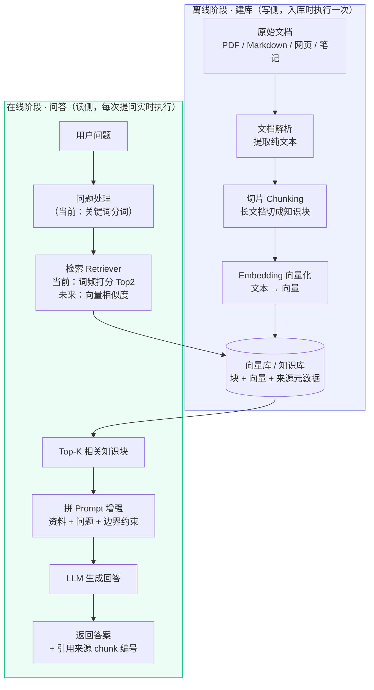
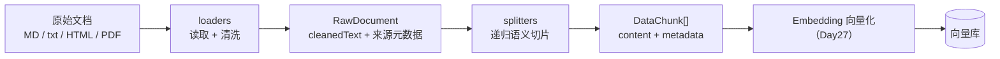

# RAG 模块架构设计文档（ai-webapp · Day24）

> 本文件对应作业 1（模块目录）、作业 2（架构图 + 架构文档）、作业 3（术语表）。
> 当天先用「关键词检索」跑通 **检索 → 拼上下文 → 生成** 整条链路；后续只替换检索器内部算法，链路不变。

---

## 一、概念自测答案

### 1. 大模型直接回答存在哪四个短板？RAG 分别怎么补？

| 短板 | 含义 | RAG 的解决方式 |
| --- | --- | --- |
| **知识截止（Knowledge Cutoff）** | 训练数据有截止日期，不知道截止之后的新政策、新产品、新文档 | 问题发生时实时从最新知识库检索资料，模型基于最新资料回答 |
| **幻觉（Hallucination）** | 模型会编造看似合理、实际不存在的事实 | 系统提示词强制「只根据资料回答」，回答被限定在检索到的内容范围内 |
| **缺乏私域知识（Private Knowledge）** | 模型没见过企业内部文档、个人笔记、行业专属资料 | 把私有文档切片入库，问答时检索注入，模型即可使用私有知识 |
| **无法溯源（No Source Trace）** | 模型说的话无法判断依据来自哪份文档 | 每个知识块带 `id` 与 `source`，回答标注 `[chunk-xx]`，可回溯原文 |

### 2. 什么是 RAG？全称与核心思想

- **RAG = Retrieval-Augmented Generation，检索增强生成**。
- 核心思想：**先检索、再回答**。回答前先从外部知识库找出与问题最相关的资料片段，把这些片段和问题一起拼进 prompt，让模型「开卷考试」，而不是「凭记忆默写」。

### 3. 离线阶段与在线阶段分别做什么？

| 阶段 | 触发时机 | 输入 | 处理动作 | 输出 |
| --- | --- | --- | --- | --- |
| **离线索引阶段（建库 / 写侧）** | 文档入库时做一次，日常更新文档时重做 | 原始文档（PDF、Markdown、网页、笔记…） | 文档解析 → 切分 Chunk → Embedding 向量化 → 存入向量库 | 可被检索的向量知识库 |
| **在线问答阶段（查询 / 读侧）** | 用户每次提问时实时执行 | 用户问题 | 问题向量化 → 相似度检索 Top-K 块 → 拼 prompt（资料 + 问题 + 约束）→ LLM 生成 → 返回答案与来源 | 带引用的回答 |

### 4. 为什么是「检索后拼进 prompt」，而不是去微调模型？

**先记结论：RAG 解决「知识」问题，微调解决「风格与能力」问题，两者分工不同。**

| 对比维度 | RAG（检索拼 prompt） | 微调（Fine-tuning） |
| --- | --- | --- |
| 知识更新速度 | 实时：改文档 / 增删块即可，立刻生效 | 慢：必须重新训练模型才能更新知识 |
| 成本 | 低：无需 GPU 训练，只调用检索与模型接口 | 高：需要标注数据集、GPU 训练与长期维护 |
| 知识来源可溯源 | 可以，每个答案对应具体文档块 | 不行，知识融进模型参数，无法追溯出处 |
| 幻觉控制 | 较可控，回答被限定在检索资料内 | 不可控，模型可能把训练知识「记混」 |
| 适用场景 | 私域问答、资料经常更新、需要引用来源、文档量大 | 改变输出风格、固定格式、领域术语表达、特定重复任务 |
| 模型本身是否改变 | 不改变模型参数，知识外置在库里 | 永久改变模型参数 |

> 一句话背诵：**知识会变、要溯源、要省钱 → 用 RAG；要固定风格、改行为能力 → 用微调；成熟系统也可以两者结合。**

---

## 二、RAG 整体架构图（离线 / 在线两阶段）



### 链路顺序背诵版（脱稿画图用）

**离线**：文档 → 解析 → 切片 → 向量化 → 入库
**在线**：问题 → 检索 → 取 Top-K 块 → 拼 prompt → 模型生成 → 答案带来源

---

## 三、术语表（作业 3）

| 术语 | 英文 | 定义 | 在本项目中的对应物 |
| --- | --- | --- | --- |
| **嵌入 / 向量化** | **Embedding** | 用 Embedding 模型把一段文本转换成一串固定长度的数字（向量）；语义相近的文本，向量在空间中距离也相近。当天骨架未使用，后续替换检索器时引入 | `retriever.ts` 未来新增的向量化步骤 |
| **向量库** | **Vector Database** | 专门存储「文本块 + 向量 + 元数据」的数据库，支持按向量相似度快速召回 Top-K；当天用内存数组代替 | 当前 `knowledge.ts` 中的 `knowledgeBase` 数组 |
| **文本块** | **Chunk** | 把长文档按段落 / 固定长度切分出来的最小知识单元，是检索与送入 prompt 的基本单位 | `types.ts` 中的 `KnowledgeChunk`，含 `id / title / content / source` |
| **检索** | **Retrieval** | 根据问题从知识库找出最相关的若干 Chunk；当天用关键词词频打分，未来换成向量余弦相似度 | `retriever.ts` 中的 `retrieve()` |
| **上下文** | **Context** | 检索后拼进 prompt、供模型作答参考的相关知识块内容；模型只能在上下文范围内回答 | `buildPrompt.ts` 中【参考资料】区块 |

### 补充：当天关键词检索 ≠ 完整向量 RAG 的关系

```
今天：问题 ──关键词分词──► 词频打分排序 ──► Top2 块 ──► 拼 prompt ──► 生成
                                                    │
Day25/27 只替换这一段 ▼
未来：问题 ──Embedding──► 向量 ──► 向量相似度排序 ──► Top2 块 ──► 拼 prompt ──► 生成
```

**除检索器内部算法外，类型、Prompt 组装、服务编排、前端展示全部保持不变。**

---

## 四、模块目录结构（作业 1）

在 ai-webapp 项目中放置如下结构（与现有 `src/lib` 同级）：

```
src/lib/rag/
├── types.ts            # 问答类型 + 数据处理类型（RawDocument / DataChunk / ChunkMetadata）
├── knowledge.ts        # 知识库（离线产物；当天为静态数组，未来来自向量库）
├── retriever.ts        # 在线检索器（Day25/27 替换为向量相似度）
├── buildPrompt.ts      # 上下文拼接 + 回答边界约束提示词
├── ragService.ts       # 在线链路编排：检索 → 拼 prompt → 调模型生成
├── loaders/            # Day26 离线读取 + 清洗
│   ├── clean.ts        # 统一清洗：换行/控制字符/HTML/页眉页脚/样板噪声/空白折叠
│   ├── markdown.ts     # Markdown loader：提取主标题
│   ├── txt.ts          # 纯文本 loader
│   ├── web.ts          # 网页 HTML loader：提取 <title>、剥离脚本与标签
│   └── index.ts        # 类型分发 + 本地文件读取
├── splitters.ts        # Day26 递归语义切片 + overlap 滑窗 + 元数据
├── index.ts            # 模块统一导出
└── ARCHITECTURE.md     # 本文档
```

### 分层职责与可插拔边界

| 文件 | 阶段 | 职责 | 是否随算法升级改动 |
| --- | --- | --- | --- |
| `knowledge.ts` | 离线产物 | 提供待检索知识块 | 替换为向量库读取 |
| `retriever.ts` | 在线检索 | 问题 → 排序 → Top-K 块；对外签名 `retrieve(question, chunks, topK)` 不变 | **只改这一个文件** |
| `buildPrompt.ts` | 在线增强 | 组装资料、问题、约束规则 | 不变 |
| `ragService.ts` | 在线编排 | 串起检索、拼接、生成，注入模型调用函数 | 不变 |
| `types.ts` | 全局契约 | 稳定的数据结构 | 不变 |

---

## 五、当前关键词骨架的验收观察点

1. 问**已收录**问题（如「项目用了什么前端框架、怎么部署」）：检索到对应块且得分 > 0，模型基于资料作答并标注 `[chunk-xx]`。
2. 问**未收录**问题（如「北京明天天气」）：所有块得分 = 0，`hasContext = false`，模型必须回答「根据现有资料，我无法回答这个问题」，不得编造。
3. 观察到的工程边界：**检索质量决定回答质量**；检索不到时，模型的「不知道」是由 prompt 约束 + 空上下文共同保证的。

---

## 六、Day26 数据处理：读取 / 清洗 / 切片（离线阶段写侧）

### 6.1 概念自测答案

#### 1. 为什么要切片？切太大 / 太小各有什么问题？

大模型上下文窗口与检索精度都有限，不可能把整篇文档一次性送入检索与 Prompt，必须先切成 **Chunk（知识块）**。

| 切片尺寸 | 优点 | 问题 |
| --- | --- | --- |
| **太大** | 单块信息完整、上下文充足 | ① 引入大量无关内容，检索时「一块里混着多个主题」，语义匹配精度下降；② 占用更多 Token，推高成本；③ 相似度被稀释，相关句子淹没在长段落里 |
| **太小** | 检索精准、Token 省 | 上下文被切断，语义不完整（一句话的前后文缺失），模型拿到碎片难以理解，回答容易断章取义 |

#### 2. `chunkSize` 和 `overlap` 各起什么作用？重叠解决了什么？

- **`chunkSize`（块大小）**：控制每个知识块的目标最大字符数，决定检索粒度与上下文完整度的平衡点。
- **`overlap`（重叠窗口）**：相邻两块之间保留一段重复文本，下一块开头复制上一块结尾的若干字符。
- **重叠解决的问题**：避免一个完整语义单元（一句话、一个论点）恰好从两块交界处被切断，导致前一块缺后半句、后一块缺前半句；重叠让边界两侧都保留上下文，跨边界问题也能被任意一块完整覆盖。
- 取舍：overlap 越大衔接越连续，但重复内容越多、Token 与存储开销越大；一般取 `chunkSize` 的 10%~20%。

#### 3. 为什么要保留来源 / 页码等元数据？

每个 Chunk 的 `metadata` 记录 `source`（来源文档）、`chunkIndex`（块序号）、`page`（页码）、`headingPath`（标题层级路径）、`charStart/charEnd`（字符区间），用途：

1. **溯源引用**：回答可以标注来自哪份文档、哪一块，用户能回查原文；
2. **定位修复**：检索或回答出错时，能定位到具体文档与位置；
3. **归属上下文**：`headingPath` 保留块所属章节，避免脱离标题后语义丢失；
4. **去重 / 更新 / 权限控制**：后续按来源批量重建索引、删除文档或做权限过滤时依赖元数据。

#### 4. 不同文档（PDF / Markdown / 网页）读取清洗要注意什么？

| 文档类型 | 读取要点 | 清洗要点 |
| --- | --- | --- |
| **Markdown** | 识别 `#` 标题层级，保留标题路径 | 剥离混入的 HTML 标签；折叠连续空行；保留标题层级与代码块语义 |
| **txt 纯文本** | 无标题层级，标题由外部元数据提供 | 统一 `\r\n` 换行；删除控制字符；去页码页眉；折叠多余空白 |
| **网页 HTML** | 抽取正文，读取 `<title>` | 先删 `<script>` / `<style>` / 注释，再剥离标签；去导航、版权、Cookie、上下篇、相关推荐等样板噪声 |
| **PDF**（后续接入） | 按页抽取文本，**必须保留页码** | 去页眉页脚、重复水印、多栏错序；处理表格与跨页段落 |

通用清洗顺序：**统一编码与换行 → 删除脚本/样式/标签 → 过滤页眉页脚与样板噪声 → 折叠空白**。

### 6.2 离线数据处理流水线（本模块实现位置）



### 6.3 切片策略与参数说明（`splitters.ts`）

1. **递归分层切分**：优先在 Markdown 标题 → 空行段落 → 句子（。！？；）→ 换行 → 空格 边界切分；仍超长才按字符硬切兜底。
2. **标题归属**：标题只更新层级栈，不产生碎片块；块正文前注入 `【一级 / 二级 / 三级】` 路径前缀，保证归属上下文不丢。
3. **正文预算**：递归拆分按 `chunkSize - 前缀预留(40)` 执行，避免加上标题前缀后整块超限。
4. **贪心打包 + overlap**：顺序合并到接近 `chunkSize` 封口；相邻块按 `overlap` 复制尾部上下文；过小尾块仅在合并后不超限才并入前一块。
5. **元数据完整**：每块记录来源、序号、页码、标题路径、字符起止区间与字符数。

### 6.4 参数调参观察（作业 3，`scripts/test-split.ts` 用例 2）

| chunkSize | overlap | 块数趋势 | 效果 |
| --- | --- | --- | --- |
| 小（200） | 小 | 块数多 | 检索精准，上下文偏碎，需要 overlap 补偿 |
| 中（400） | 中（60） | 块数适中 | 粒度与完整度较均衡，常见默认区间 |
| 大（600） | 大（80） | 块数少 | 上下文完整，但检索精度下降、Token 开销上升 |

> 选型建议：问答型知识库 `chunkSize` 多取 300~500 中文字符，`overlap` 取 30~80；代码、表格等强结构文档按其自身边界切分，不套用统一字符长度。
